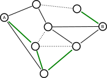

# Shannon Switching Game

  

Diagram by Dantesoft, via Wikimedia Commons · CC0 public domain. <a href="docs/IMAGE_CREDITS.md">Source and image credits</a>.

**Connect a route. Cut it off. Make every move count.**

Two connection games built with Godot: **Shannon Switching** and **Gale’s Game**. Challenge a friend on the same computer, play against the AI, or build your own network.

**An itch.io release is planned.** Until it is published, you can play from the source using the local setup below.

## How to play

### Shannon Switching

Two players share a network between **S** (start) and **G** (goal).

- **Short** plays first and claims one available link per turn. Claimed links are protected.
- **Cut** removes one unclaimed link per turn.
- **Short wins** by completing a route of claimed links from S to G.
- **Cut wins** when no possible route remains.

Play locally with a friend, face the AI as either role, or watch two AIs compete. Choose the classic board, generate a random network, or create your own.

### Gale’s Game

Two players compete on crossing grids. **Blue connects top to bottom; Red connects left to right.** Each claimed link blocks the crossing link on the opponent’s grid. The first player to connect their sides wins.

Gale’s Game supports local two-player matches.

## Controls

| Input | During a match |
| --- | --- |
| Left click | Select an available link |
| WASD or arrow keys | Pan the board |
| Middle-mouse drag | Pan the board |
| Mouse wheel over the board | Zoom toward the cursor |
| F | Reset the board view |
| R | Restart the current board after confirmation |
| M | Toggle sound |
| Esc | Return to the menu after confirmation |

Open **How to play** for the rules during a match; the game pauses while they are open. The sound setting is saved between sessions. Restarting or replaying a Shannon match preserves its layout and selected terminals.

## Create a custom board

1. Choose **Play Shannon → Create your own**.
2. Select **Add Node**, then click the board to place nodes.
3. Select **Add Edge**, then drag between nodes to connect them.
4. Select **Start Game**, then choose the start and goal nodes.

The editor checks that your selected start and goal are connected before play begins.

## Run locally

Use **Godot 4.7**, the version recorded in `project.godot`. The standard editor is sufficient: this project uses GDScript and does not require .NET.

1. Clone this repository or download and extract its ZIP.
2. Import `project.godot` in Godot.
3. Let the asset import finish.
4. Press **F5** or **Run Project** to open the main menu.

## Export for itch.io

The **Web** preset exports to `builds/web/index.html`. It uses the Compatibility renderer with thread support disabled.

1. Install export templates matching your Godot editor under **Editor → Manage Export Templates**.
2. Create a `builds/web/` folder at the project root.
3. Open **Project → Export**, select **Web**, and use **Export Project** with **Export With Debug** unchecked.
4. ZIP the **contents** of `builds/web/`, keeping `index.html` at the ZIP root alongside every generated asset. Keep the exported filenames unchanged.
5. Create an itch.io project of type **HTML**, upload the ZIP, and select it as the browser-playable build.
6. Use a **1200 × 760** embed with a fullscreen button. Test the uploaded draft before publishing.

Add the public itch.io game link to this README once the release is live.

The **Windows Desktop** preset is also available, with output under `builds/windows/`; create that directory before exporting. Generated builds and release ZIPs stay out of Git.

References: [Godot Web export](https://docs.godotengine.org/en/stable/tutorials/export/exporting_for_web.html) · [itch.io HTML5 uploads](https://itch.io/docs/creators/html5).

## Release checks

Before publishing, try a Shannon match as each role, an AI match, a custom board, and a Gale match. Check pan/zoom/reset, sound, replay, and fullscreen in the uploaded itch.io draft. Watch Godot’s debugger and the browser console for errors.

## Project layout

| Path | Purpose |
| --- | --- |
| `scenes/` | Menus, gameplay, HUD, and custom editor scenes |
| `scripts/` | Game rules, AI, graph generation, and shared state |
| `scripts/ui/` | Interface, styling, and procedural artwork |
| `images/` | Application icons |
| `audio/` | Music and sound effects |
| `docs/` | Repository cover artwork, excluded from game imports |
| `builds/` | Local exports, ignored by Git |
| `export_presets.cfg` | Web and Windows export configuration |

## Credits

Created by **Team 4 · COMP530**.
